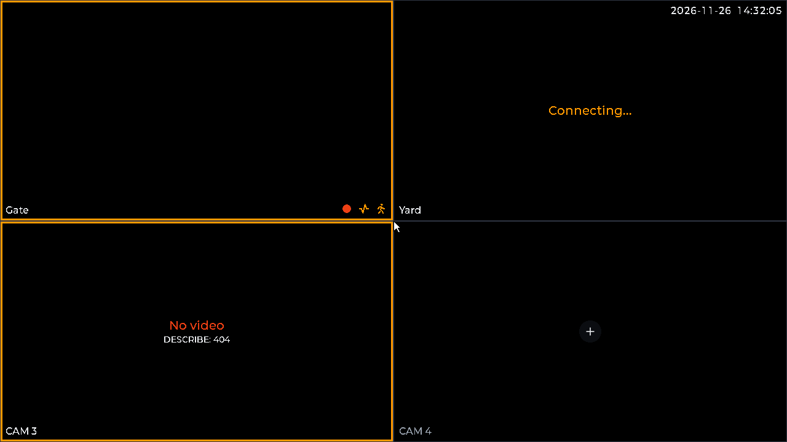
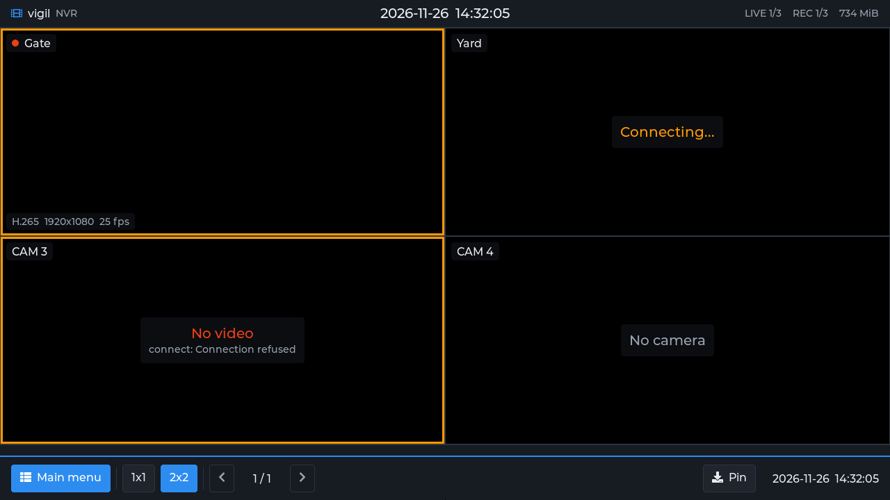
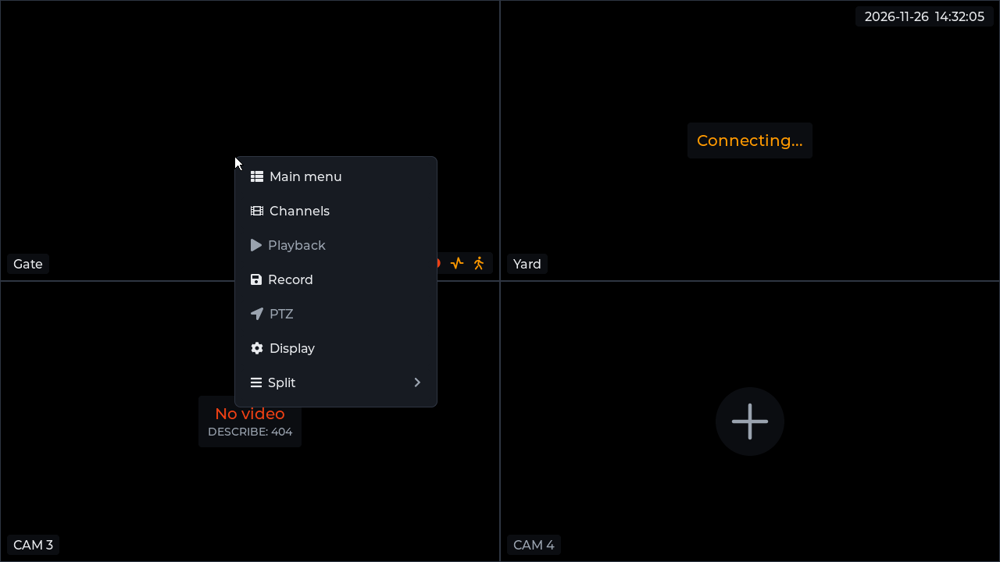

# The on-screen UI

`vigild` draws its user interface on the board's HDMI output with
[LVGL](https://lvgl.io) (v9.2), on the graphics layer above the video. It
is operated with a USB mouse (or a touch screen). This page describes how
the UI is built, how it gets its data, how the settings pages come from the
configuration schema, and how to run and test it without a board.



## Screens

```
live view                  tiles over the video, header, event strip
 |  navigation bar         bottom edge; Main menu, 1x1 / 2x2, < page >, Pin, clock
 |  context menu           right button: Main menu, full screen, layouts, pages, pin
 +-> Main menu             one tile per settings section + System
      +-> Cameras          the camera list: Add, Edit, Remove
      |    +-> a camera    form: URL, name, enabled
      +-> Recording        form
      +-> HTTP API         form
      +-> System           platform, version, uptime, memory, storage (read-only)
```

**Live view.** A header (product and role, date and time, LIVE/REC totals),
the grid, and the last events. Each tile is a *hole*: LVGL paints it in the
colour the platform keys out (or fully transparent where the UI layer has
alpha, `hal_ui_hole`), so the decoded video below shows through. On it sit
small opaque chips: the camera's name from the configuration (or `CAM n`)
with a red dot while recording, and either the stream (`H.265 1920x1080
25 fps`) or the state (`Connecting...`, `No video` with the reason,
`No camera`). A tile flashes when its camera has an event.



The **navigation bar** slides up when the pointer reaches the bottom edge
of the screen and hides 3 s after the pointer leaves it, unless pinned. The
**context menu** (right button) offers the same actions, plus "Full
screen" for the tile under the pointer. **Double-clicking** a tile shows
that channel full screen; double-clicking again returns to the layout
before.



Layouts are 1x1 and 2x2 on today's platforms; 3x3 and 4x4 are offered once
a platform reports more than 4 or 9 channels (`hal_caps()->max_channels`).
Paging walks through the channels a page at a time (1x1 with four cameras:
four pages). On a platform whose tiles are fixed (`fixed_tiles`, the
hi3520dv200 capture pipeline), only the 2x2 view is offered.

**Main menu and pages.** Every page has a header with Back, its title,
its actions (Save, Cancel, Add) and the clock. Back is the header button or
the **right mouse button**, which goes back one level (closing the
keyboard or a question first).


## Architecture

```
src/app/frontend_ui.c   main loop: lv_timer_handler, applying configurations (tick)
src/app/ui_bridge.c     ui_model_t from the core: channels_status, events cursor,
                        channels_set_tiles, config store + schema, system info
src/app/input_evdev.c   mice / touch screens -> LVGL pointer, right button -> back
        |
        v  ui_model.h (no core types)
src/ui/ui_app.c         screen stack, subjects, popups, toasts, questions
src/ui/ui_live.c        live view, navigation bar, context menu
src/ui/ui_menu.c        main menu
src/ui/ui_form.c        settings forms and lists, from the schema
src/ui/ui_system.c      System page
src/ui/ui_events.c      event strip
src/ui/ui_layout.c      tile geometry (plain C, shared with frontend_tiles)
src/ui/ui_theme.c       LVGL styles from the design tokens
src/ui/ui_cursor.c      the software mouse pointer
```

The layering rule holds: `src/ui` includes LVGL and `hal_ui.h` only. All
it knows about the rest of vigild is `ui_model.h`, a table of functions and
plain data that `src/app/ui_bridge.c` fills from the core. The tests fill
the same table with fake channels.

Everything runs on the main thread. Channel threads never touch LVGL:

- **Status**: every 250 ms the UI asks the model for each channel's
  snapshot (`channels_status()` underneath) and, when one changed, notifies
  that channel's `lv_subject`. Tiles and the header totals observe the
  subjects, so they redraw only when something changed.
- **Events**: the UI has its own cursor on the events ring (as the API's
  WebSocket has), so it sees every event; they go to the strip and flash
  the tile.
- **Configuration**: the store's generation is a subject too. The camera
  list observes it and rebuilds when the configuration changed, whether
  the change came from this UI or from the HTTP API.
- **Clock** and **navigation bar pinned** are subjects as well; the header,
  the bar and the pages bind labels to the clock (`lv_label_bind_text`).

**Layouts move the video.** Changing the layout, the page or going full
screen computes the cells (`ui_layout_cells`) and hands one rectangle per
channel to `model->show_tiles`, which calls `channels_set_tiles()` in the
core. That moves each running channel's picture with the existing HAL calls
(`hal_display_set_tile`, or `hal_display_clear_tile` for a channel not on
the page) and remembers the tiles for channels that start later. The same
`ui_layout_cells` gives `frontend_tiles()` the start-up 2x2 tiles, so the
holes and the video cannot disagree. On SigmaStar the decoder's output
stays at the size of the tile it was opened for; a channel shown full
screen is scaled up by the display until its decoder is opened again.

## Settings pages from the schema

The settings are the table in `src/core/config_schema.c`, the same one
`GET /api/v1/schema` serves. `ui_bridge.c` turns it into `ui_section_t` and
`ui_field_t` at start-up, and the UI builds every form from those at run
time:

| Schema type | Widget |
|---|---|
| string | one-line text area; the on-screen keyboard opens on it |
| integer | text area for digits with `-` / `+` buttons kept within min..max; the range is shown |
| boolean | switch |
| enum | drop-down list of the values |

The field's `label` names the row and its `help` is shown under the widget.
A field that is not `live` carries "applies after restart". A section that
is an array of objects (the cameras) becomes a list with Add, Edit and
Remove; Edit and Add open a form for one item.


**Saving** sends the whole section to `config_put_json()`, the function
behind `PUT /api/v1/config/<section>`: the values are checked against the
schema, the file is saved atomically, the generation moves, and the main
loop applies the new configuration (`channels_apply`), exactly as for an
API request. When the store refuses, nothing is changed and each of its
errors (`record.path: must be an absolute path`) is shown under its field,
with a toast. A success shows "Saved" (or that some changes apply after a
restart); a configuration that was saved but whose directory sync failed
shows the store's warning.

**Secrets.** Camera URLs are shown as the API shows them, with the password
replaced by `***`. A URL saved back unchanged keeps the stored password
(the store's rule for `***`); typing a new URL replaces it.

Leaving a page with unsaved changes asks first. Removing a camera asks
first and saves at once.


### Adding a setting to both UIs

1. Add the member to `vigil_config_t` (`src/core/config.h`).
2. Add a row to `src/core/config_schema.c`: key, type, default, limits,
   `label`, `help`, `live`, and a `check` function if it needs one.
3. Use the value where it applies (`channels_apply`, or wherever it is
   read).

Nothing else: the HTTP API, `GET /api/v1/schema`, the configuration file
and the on-screen settings page all follow from the row. A new section
gets its own tile in the main menu (give it a symbol in
`ui_menu.c:section_symbol`, or it gets a generic one).

## Design tokens

The look is defined once, in `src/ui/theme.json`: colours of the dark NVR
theme (`bg`, `panel`, `panel2`, `hover`, `line`, `accent`, `ok`, `bad`,
`warn`, `text`, `text2`, `chip`), spacing, radii, font sizes, component
sizes and durations (navigation bar hide delay, double-click interval,
toast). `scripts/gen-theme.py` (Python 3, standard library) generates

- `src/ui/theme_tokens.h`: `VG_COLOR_ACCENT`, `VG_SPACE_MD`,
  `VG_FONT_LG_LV` (the LVGL font), `VG_DURATION_NAVBAR_HIDE`, ...; and
- `web/theme.css`: the same values as CSS custom properties
  (`--vg-color-accent`, `--vg-space-md`, ...) for the web UI.

Both outputs are committed, so building needs no Python; the
`theme_tokens` test fails when they do not match `theme.json`. To change
the look: edit `theme.json`, run `scripts/gen-theme.py`, regenerate the
reference screenshots (below), commit all of it.

Everything drawn over a video tile is opaque and has no shadow: on a
colour-keyed layer (HiSilicon hifb, SigmaStar GOP) a half-transparent pixel
is a blend with the key colour and shows as a pink fringe.

## Input

`src/app/input_evdev.c` reads every `/dev/input/event*` that is a pointer:
a mouse (relative X/Y and a left button) or a touch screen or tablet
(absolute X/Y). All of them move one LVGL pointer. The directory is scanned
again every 2 s, so a mouse plugged in later works (the boards have no
udev). The left button clicks; the **right button** calls `ui_app_back`.

LVGL's own evdev driver (`LV_USE_EVDEV`) is not used: it opens one device
and reports only `BTN_MOUSE`/`BTN_TOUCH`, so the right button would be
lost. Button changes are queued, so a click shorter than LVGL's input poll
(33 ms) still counts. The reader is in `src/app` rather than `src/core`
(it needs Linux headers, which the core must not depend on) or `src/ui`
(LVGL only); it is plain Linux, so every platform with a display uses it.

The pointer is drawn by LVGL (`ui_cursor.c`, an arrow with only opaque and
fully transparent pixels), shown while a pointer device is present. A
physical keyboard and remote controls (LVGL `gridnav`) are not handled yet.

## Running and testing without a board

`test_ui` (built in every host build, run by `ctest`) is the UI without
hardware: LVGL renders into memory, a pipe stands in for the mouse and goes
through the real evdev reader, settings go through the real configuration
store (a file in the build directory), and only the channels, events and
clock are fakes. It walks through the screens with the mouse, checks the
widget states (tile texts, the navigation bar showing and hiding, the
context menu, full screen and back with the rectangles handed to the
platform, a validation error with nothing saved, a change saved and in
force, the camera password kept) and writes a screenshot of each step.

`tests/ui_compare.py` compares those with the references in `tests/ui/*.png`
(a pixel differs when a channel is off by more than 24; at most 0.3 % may
differ) and writes a `.diff.ppm` for a screen that does not match. After an
intended change to the look:

```sh
cmake --build build && (cd build && UPDATE=1 ctest -R ui_screens)
git add tests/ui
```

The screenshots on this page are those references. No display, SDL or GPU
is needed, so this runs in CI. There is no interactive desktop simulator
yet: an LVGL SDL window (`hal_ui` for the generic platform) is the
natural next step.

On a board, `vigild` logs each pointer device it finds
(`input: <device> (<name>): mouse`) and when one goes away.
