# The on-screen UI

`vigild` draws its user interface on the board's HDMI output with
[LVGL](https://lvgl.io) (v9.2), on the graphics layer above the video. It
is operated with a USB mouse (or a touch screen), a USB keyboard, or both.
This page describes how
the UI is built, how it gets its data, how the settings pages come from the
configuration schema, and how to run and test it without a board.


## Screens

```
live view                  tiles over the whole screen, clock in a corner
 |  navigation bar         bottom edge; Main menu, layouts, < page >, Pin, totals, clock
 |  page arrows            < > at the left and right edges, half way down
 |  context menu           right button: Main menu, Channels, Playback, Record, PTZ,
 |                         Display, Split > (layouts)
 +-> Main menu             cards: PLAYBACK, AI, ALARM, OPERATION, BACKUP, DISPLAY
      |                    MANAGEMENT: CAMERA, NETWORK, STORAGE, SYSTEM, ACCOUNT
      +-> CAMERA           Channels: cameras found on the network (Search, Add,
      |    |               Change IP, Mass change, Auto add, Manual add; Show) and every
      |    |               channel (bandwidth; X / +; Clear, Delete, Edit, Title)
      |    +-> a camera    form: URL, name, enabled
      +-> NETWORK          settings screen: Ethernet, Wi-Fi, LTE, Ports, DDNS,
      |                    UPnP, SMTP, Alarm center, QoS, P2P
      +-> STORAGE          settings screen: Basic, Schedule, Disk Manager,
      |                    Disk Maintenance, Disk Quota, Network Storage
      +-> SYSTEM           settings screen: General, HTTP API
      +-> ACCOUNT          settings screen: Users, Groups
      +-> OPERATION        platform, version, uptime, memory, storage (read-only)
      |               +-> Channel info: every channel's state, stream, codec,
      |                   size, fps, main stream, recording, events
      +-> DISPLAY          settings screen: Output, Clock, Camera names,
                           Status icons, Video, Tiles
```

**Live view.** The tiles take the whole screen (2x2 on a 1280x720 output:
four 640x360 tiles); there is no header or footer bar. Each tile is a
*hole*: LVGL paints it in the colour the platform keys out (or fully
transparent where the UI layer has alpha, `hal_ui_hole`), so the decoded
video below shows through. In one corner (bottom left by default), the
camera's name from the configuration (else the name a NETIP camera gives
the channel, its ChannelTitle; else `CAM n`) as outlined text straight
on the picture (see below); in another (bottom right), icons only, a red
dot while the channel records and an amber icon for each event the camera
reports now (motion, human, face, vehicle; each held 5 s after the camera's
last report). Where they go, their size and what they stand on are
`display.*` (Display, below), and so are whether REC and the event icons
are shown at all, the 1-pixel line around each tile (2 px between two;
without it the pictures touch), and an alarm frame: a red 3-pixel frame
inside the edge of a tile while its camera reports any event, blinking
(750 ms on, 250 ms off; on and off, never faded, as a translucent edge over
a colour-keyed hole would show the key colour), off by default. The events
come from `channels_report_events` (NETIP alarms and ONVIF events are to
come) or from outside, `POST /api/v1/channels/<n>/events`
([API](api.md)). The stream's codec, size
and frame rate are not on the tiles but on the Channel info page
(System). The middle of a tile says something only when there is no
picture, outlined like the name. It is about the stream on screen: a small
tile showing the sub-stream is live while its sub-stream plays, whatever the
main stream does; the main stream's own state is the Channel info page's
*Main stream* column (and the recording's state says why nothing is
recorded):

| `status` (core `ch_state_t`) | Tile |
|---|---|
| `connecting` | Connecting... |
| `offline`: refused, timed out, no route, connection lost | Offline |
| `auth`: RTSP 401/403, NETIP login 203/205/206 | Authentication error |
| `codec`: neither H.264 nor H.265 | Unsupported codec |
| `no_video`: connected, no video for 3 s | No video |
| `error`: anything else | No video, and the error |
| `disabled` | Disabled |
| `live`, but no decoder free | No decoder |
| `empty`: no camera in this slot | a small "+" |

The **"+"** of an empty slot, a 36-pixel disc with "Add camera" under it
while it is hovered or its tile has the keyboard (a click, or Enter on its
tile) opens the Channels page, as the context menu's Channels does (and
with the same `cameras` permission), with that channel marked and scrolled
into view: a device found goes straight there (Add, or "Add checked" on
its row), Manual add offers it first, and its row's Add opens the camera
form for it ("Cameras 7: new"); saving puts the camera at that position,
the slots before it staying empty. There is a tile for
every channel the platform shows (`hal_caps()->max_channels`), paged by
the layout. A tile flashes when its camera has an event.

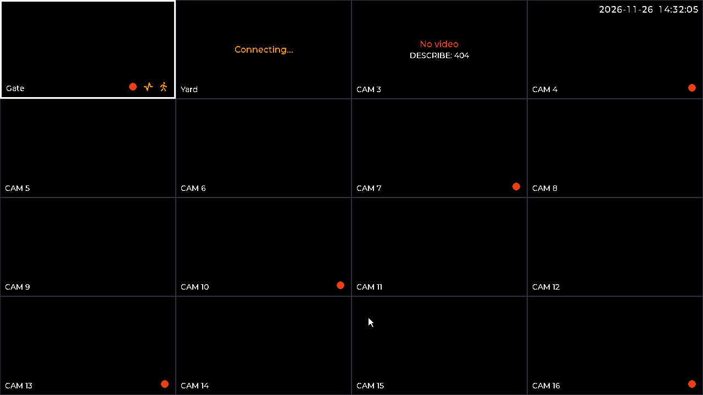

The date and time are at the top right of the screen by default, outlined
like the names; `display.clock_position` puts them in another corner, the
middle of the top or bottom edge, or nowhere. A name or the icons that
would meet the clock move inward (down from the top, up from the bottom)
past it, in whichever tile and corner that happens; icons in the names'
corner go just past the name.

Camera events are wired through (`channels_report_events`, `events` in the
channel status, the API and `ui_chan_t`) but nothing reports them yet:
the icons appear once a source does (camera alarms over NETIP and ONVIF
events are the next step).

**Events.** The live view has no event list; the HTTP API's WebSocket
carries every event. A tile shows its channel's state all the time, so
only what the tiles do not show becomes a toast at the top of the screen:
recording trouble (`REC failed`, `REC waiting for disk`, ...), a channel
that cannot run (`no decoder`, `bad URL`), a configuration that could not
be applied, and a camera going offline or coming back while its tile is not
on the screen. The same trouble on several cameras at once is one toast
(`2 cameras: REC waiting for disk`). `REC on`, `online` for a tile in
view, `config applied` and the like would only be noise.


The **navigation bar** slides up over the video when the pointer reaches
the bottom edge of the screen and hides 3 s after the pointer leaves it,
unless pinned. Besides the actions it shows the LIVE and REC totals and the
clock. **Double-clicking** a tile shows that channel full screen;
double-clicking again returns to the layout before.

**Page arrows.** With more channels than windows, a round arrow comes up
while the pointer moves within 80 pixels of the left or right edge in the
middle third of the height: previous page on the left, next on the right.
It goes when the pointer leaves, or after 2 s without moving. Opaque, like
every chip over the video. PgUp/PgDn and `[`/`]` do the same.

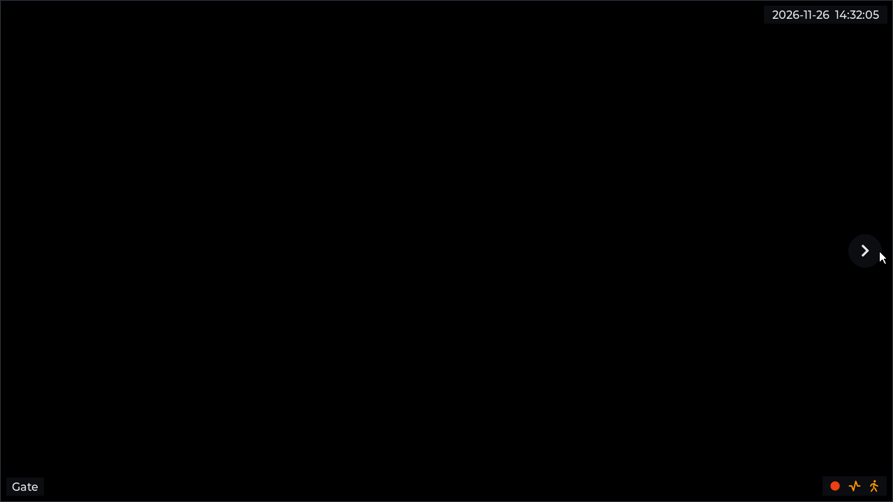

The **context menu** (right button, or the Menu key) is, in this order:
**Main menu**; **Channels** (the Channels page); **Playback**; **Record**
(the recording settings); **PTZ**; **Display** (the Display settings
screen, below); **Split**, a
submenu of the layouts; and **Exit**: Logout, Reboot, Shutdown, Cancel
(below). Nothing else (full screen is a double click or Enter, pages the
arrows, pinning the bar its own button). Playback and
PTZ are not in vigil yet: they
are in the menu, muted, and say "not available yet" when chosen; they are
placeholders for what comes next.

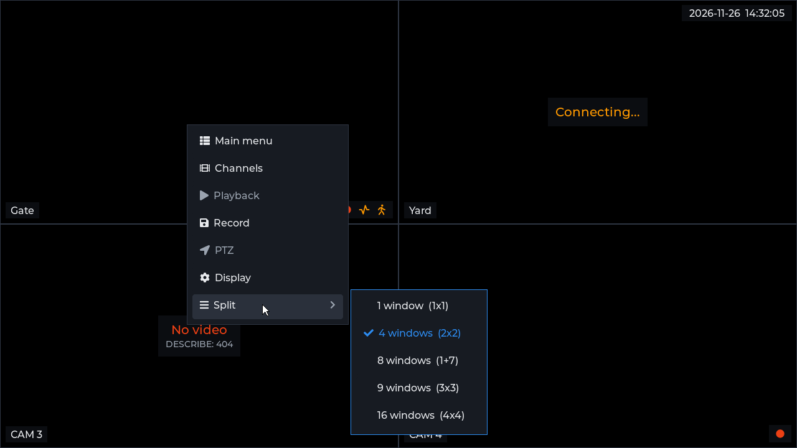

**Split** offers 1, 4, 8, 9, 16, 32 and 64 windows, those up to the
number of channels the platform can show (`hal_caps()->max_channels`;
today every platform reports 4, so 1 and 4); the current one is checked.
The geometry is `ui_layout_cells`: N x N grids for 1, 4, 9, 16 and 64;
**8** is the classic one large window (3 x 3 cells of a 4 x 4 grid) with
three small ones down the right and four along the bottom; **32** is an
8 x 4 grid of equal windows, which on a 16:9 screen is the usual way to
show 32. Window edges are on 16-pixel columns and even rows. Paging walks
through the channels a page at a time (1 window with four cameras: four
pages). On a platform whose tiles are fixed (`fixed_tiles`, the
hi3520dv200 capture pipeline), only the 2x2 view is offered, and the
capture tiles keep the size and place the encoder needs (640x288, between
where the old header and event strip were), so they sit inside the
full-screen holes with a black band above and below; not run on that
board.

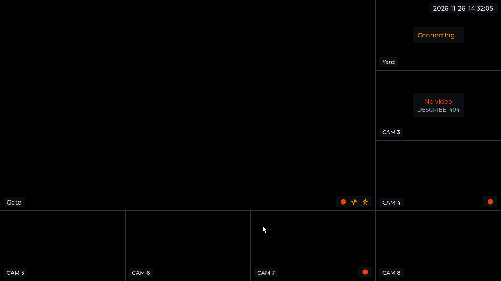

The 16- and 64-channel pictures here come from the headless test, which
fakes those capabilities.

**Main menu.** A bar at the top (vigil and the role, "Main menu", the
clock, **LIVE** back to the live view, and the account icon, muted: the
on-screen UI does not log in yet, so there is no log-out either), six function cards
(3 x 2, a large icon, an upper-case title and what it is for), and the
**MANAGEMENT** row of the settings. The cards: PLAYBACK, AI, ALARM,
OPERATION (the System page), BACKUP and DISPLAY (the Display page).
PLAYBACK, AI, ALARM and BACKUP are not in vigil yet: their cards are
there and say "not available yet", the same as Playback and PTZ in the
context menu. Six cards fill one page at 1280x720, so there are no page
dots. The management row: CAMERA (the Channels page), NETWORK, STORAGE,
SYSTEM and ACCOUNT, each a settings screen (below). The arrows move over
the cards and along the row, Tab goes from the cards to the row to LIVE,
Esc and the right button go back to the live view. The background is a
dark navy vertical gradient (`menu_top`, `menu_bottom`), the cards a
little lighter (`card`, `card_hover`).


**Pages.** Every other page has a header with Back, its title, its
actions (Save, Cancel, Add) and the clock. Back is the header button, the
**right mouse button** or **Esc**, which go back one level (closing the
on-screen keyboard or a question first). The **mouse wheel** scrolls the
list or page under the pointer (`ui_app_wheel`; LVGL's pointer has no
wheel), two table rows a notch; lists that can scroll show a scroll bar.

### Settings screens

NETWORK, STORAGE, SYSTEM and ACCOUNT open the classic NVR settings
layout (`ui_settings.c`): a list of sub-pages on the left, each an icon and
a label, the one shown in the accent colour; the sub-page on the right; and
in the header, "Network › Ethernet", Cancel and Save for that sub-page
(none on a sub-page with nothing to save: a status, an action list, "No
Wi-Fi adapter"). Leaving a sub-page or the screen with unsaved changes
asks first, as every page does. With a keyboard: Tab goes Back, the list
(Up and Down move in it, Enter opens one), the sub-page's widgets, Cancel,
Save; Ctrl+S saves.

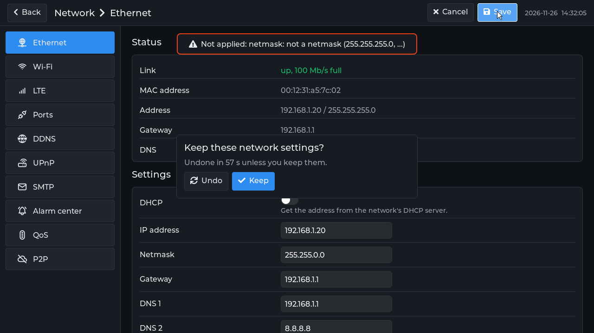

A sub-page is either a schema form placed in the pane (`ui_form_embed`:
DDNS, UPnP, SMTP, Alarm center, Network Storage, HTTP API are sections of
`vigil.yaml` and need no code of their own beyond the action they offer)
or widgets of its own built from `ui_settings.h`'s blocks (a titled panel,
label/widget rows, read-only rows, text, numbers, switches, drop-downs).
What changes the system goes through the model's management calls
(`ui_mgmt_t` in `ui_model.h`, filled by `src/app/ui_mgmt.c` from
`src/sys`); a slow one is a job the sub-page follows on a timer
(`ui_set_follow_job`), so the screen never waits.

**Network.** *Ethernet*: the link (speed, duplex), MAC and the addresses
in use, refreshed every 2 s; DHCP, address, netmask, gateway, two DNS
servers, MTU. A bad value is marked and named in a toast; an applied change
asks "Keep these network settings?" with the seconds left before it is
undone (Keep, Undo) — on whatever screen is open by then, since the
recorder may have been cut off by the change. *Wi-Fi*: a USB adapter (its name and USB id,
its driver and the firmware profile that loads it, `wlandev`), the
interface's state once it is up, the network to join (Scan once the
interface is up and `iw` is there) and the password; with an adapter whose
interface is not up yet, Save also sets `wlandev` and loads the driver;
without one, "No Wi-Fi adapter" and nothing to fill in. *LTE*: the USB
modems plugged in, each with its driver and profile and "Use this profile"
(`wlandev`, for the next boot), and the modem's interface once it is up;
or "No modem found". *Ports*: the web server's, the HTTP API's, the ONVIF
server's and the NETIP server's ports (`web.listen`, `api.listen`, the
address part kept; `onvif_server.port`, `netip_server.port`), each with
what it listens on now, refreshed every second, or why not, or the last
move that failed; and, under "Services not available yet", the RTSP
port, with a note that nothing listens on it. Save refuses two on one
port (the one changed is marked, both named in a toast) and saves one
section at a time, those moving onto a port another one leaves last; the
store refuses a port that is taken, with the reason, and the port typed
stays there, marked. The web and API ports need the users permission
too, as their sections do. *DDNS*, *SMTP*: the form, the last
update or mail and its result, and "Update now" / "Send test mail" (which
use the saved settings: with unsaved changes they ask to save first).
*UPnP*: the form, marked not active. *Alarm center*: the form and the last
post. *QoS*: `qos`, the DSCP vigild marks its packets with: the type (Off,
Standard (RFC 4594), Custom) and, unless off, a number 0..63 per traffic
class with its name beside it (AF41, CS2, EF, ...): Video (the zero
channel's picture), Management (the API, the web pages, DDNS, camera
searches), Cameras (vigild's connections to them), Alarms and events.
Standard shows its values greyed; Custom makes them editable. Saved, it
applies at once: new connections, the cameras' sessions and open
WebSockets are marked again; an open web page or API connection keeps its
mark until it reconnects. *P2P*: vigil has none, said so.

**Storage** (also the context menu's Record). *Basic*: when the disk is
full (Overwrite: the oldest recordings make room; Stop: recording stops
until there is room), the segment length in minutes (the file keeps
`record.segment` in seconds; a value that is not whole minutes is shown
rounded with what is stored, and kept unless changed), the recording
directory with a button for each mounted disk's `/mnt/<dev>/rec` and the
network storage's, recording onto the root filesystem, and each camera's
recording state. *Schedule*: a camera, a brush (Continuous, Motion only,
Off) and the week as one drawn grid of 7 days by 48 half hours; click or
drag to paint, or with the keyboard move a cursor with the arrows and paint
with Space or Enter; copy a day to every day, a week to every camera,
Always, Never. Edits to several cameras are kept until Save; a week that is
all Continuous writes no entry. Motion only is explained: no camera source
reports motion yet. *Disk Manager*: disks and their partitions (model or
filesystem, size, free, mount point, state), refreshed every 2 s so a disk
plugged in shows up; Format, Mount and Unmount per row (never on a device
that holds the system); Format (ext4 by default where the firmware has
`mkfs.ext4`, else exFAT) opens a panel in the page with the
filesystem, a field to type the device's name and a Format button that
works only when the name matches; it runs as a job. A surface scan under
way shows as a line above the table and its disk's state, `scanning`.
*Disk Maintenance*: a disk (whole disks only) and two tabs. *SMART*: the
verdict (Good, Warning, Failing, or Unknown where the drive gives none, as
a USB stick) with its reason, the identity (model, serial, firmware,
capacity, rotation or SSD, SATA link, temperature, hours, the drive's own
check), Short and Extended self-tests (Abort while one runs; it is read
again every 30 s meanwhile), the attribute table with amber rows for counts
that should be zero and red ones at or below their threshold, and the
self-test log; read as a job, since a sleeping disk spins up first.
*Surface scan*: mode (Read, Verify, Write), block size, start and end LBA,
Start, or Pause/Resume and Stop while one runs; the sector map, one drawn
object of up to 2000 cells coloured by the worst latency class in each,
the current position outlined; the counts per class, speed, elapsed and
left, the bad LBA ranges. Write first opens a panel naming the disk's
model, serial and size and wants its name typed. The scan runs in vigild:
the page can be left and shows it again when opened (on the scan's tab).
*Disk Quota*: per
camera, the most gigabytes and days. *Network Storage*: whether SMB and NFS
can be mounted here and why not, the share's state, its form, Test, and
"Record here" (`record.path` = `/mnt/nas/rec`).

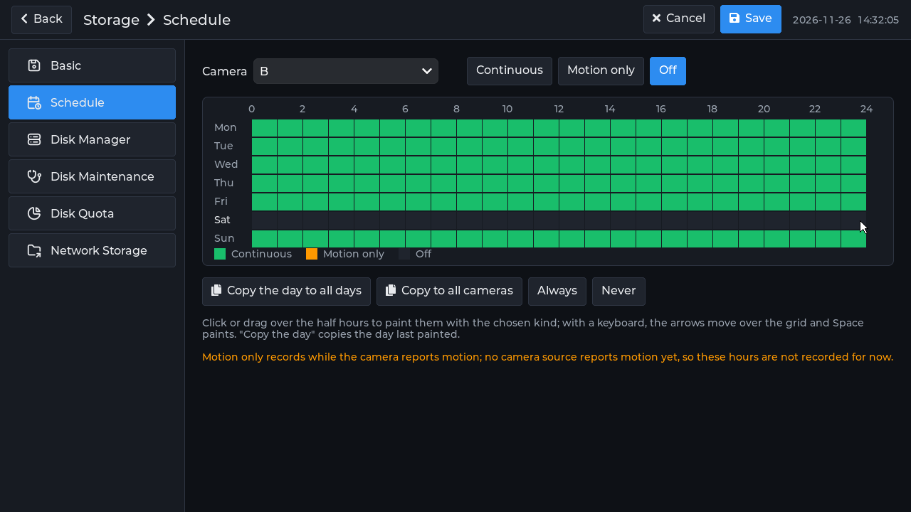

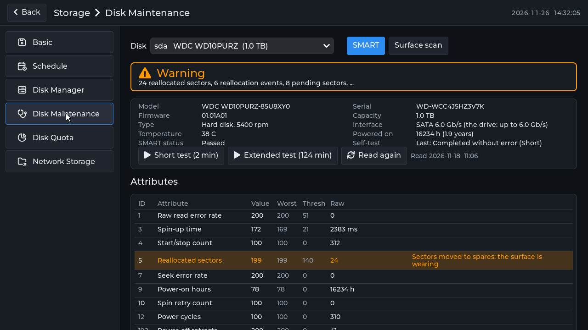

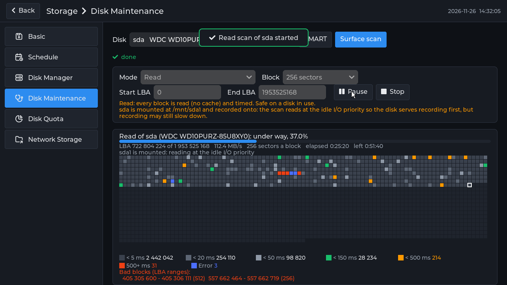

**System.** *General*: the device name (the host name; shown in the main
menu's bar and the API's status), the language (the languages there are),
the date and time formats (the clock follows at once), the time now and
"Set the clock", the time zone (a named one, described in words — offset,
and when daylight saving time starts and ends — or Custom: an offset,
daylight saving time with how far the clocks go forward and the week,
weekday, month and time it starts and ends, previewed as its POSIX string),
and NTP (on or off, servers, how often vigild checks, Sync now and the last
sync). Save writes only the parts that changed. *HTTP API*: the API's form.
*Zero channel*: the `web` section's form (on or off, where it listens, the
most pictures a second): this screen in a browser (below, Input).

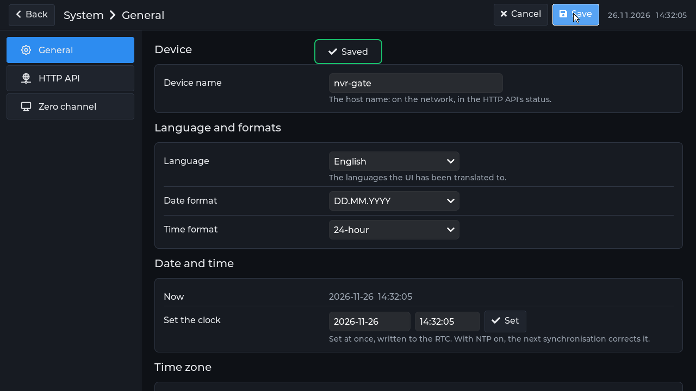

**Account.** *Users*: name, group, enabled, password set; Add and Edit open
an editor in the pane (an empty password on Edit keeps it), Remove asks
first; the list follows changes made through the API. Changes apply at
once. *Groups*: a row per group with a toggle per permission (Live,
Playback, PTZ, Cameras, Storage, Network, System, Users, Remote: the zero
channel, this screen from a browser), saved with Save;
`admin` is read-only, `user` cannot be removed. The on-screen UI does not
ask for a login yet: the accounts are enforced on the HTTP API, where the
system account (root) always logs in as an administrator.

**Display.** *Output*: the resolution in use and the board's modes
(`ui_model_t.out_modes`, from `hal_display_modes`). Save switches at once
and asks "Keep this resolution?" with a 15 s countdown; Keep saves
`display.output`, while Undo, Esc, the right button or no answer put the
old mode back and save nothing, so a monitor that cannot show the new mode
gets its picture back by itself. The menus keep their 1280x720 layout and
are scaled to the output (stretched on a 5:4 or 16:10 monitor); a board
with one mode says so. *Clock*: position (off, a corner, the middle of the
top or bottom edge), size, background, and the date and time formats (the
same settings as System, General). *Camera names*: position (off or a
tile corner), size (a step smaller in tiles under 400 pixels wide),
background. *Status icons*: REC and Alarms (`display.rec_icon`,
`display.alarm_icons`, switches, on by default), the corner, background.
*Tiles*: Lines between tiles (`display.tile_dividers`, on) and Alarm frame
(`display.alert_frame`, off). *Video*:
`display.video_aspect`, Fit (the default: each picture at its camera's
shape inside its tile or the full screen, black bars where the shapes
differ, a sub-stream at its main stream's shape; see
[architecture](architecture.md)), Stretch (the picture fills the tile,
whatever its shape) or Fill (the picture keeps its shape and covers the
whole tile, what overflows cut off: the top and bottom of a 4:3 camera in a
16:9 tile).
Sizes are Small,
Medium, Large and Extra large (Montserrat 14, 16, 20, 24: the only font
built in; another family would cost the firmware's flash). Backgrounds are
**Outline** (the default: hard-edged text with a black outline straight on
the video), **None** (hard-edged, no outline) and **Box** (the opaque chip
of earlier versions). A save applies to the live view at once.

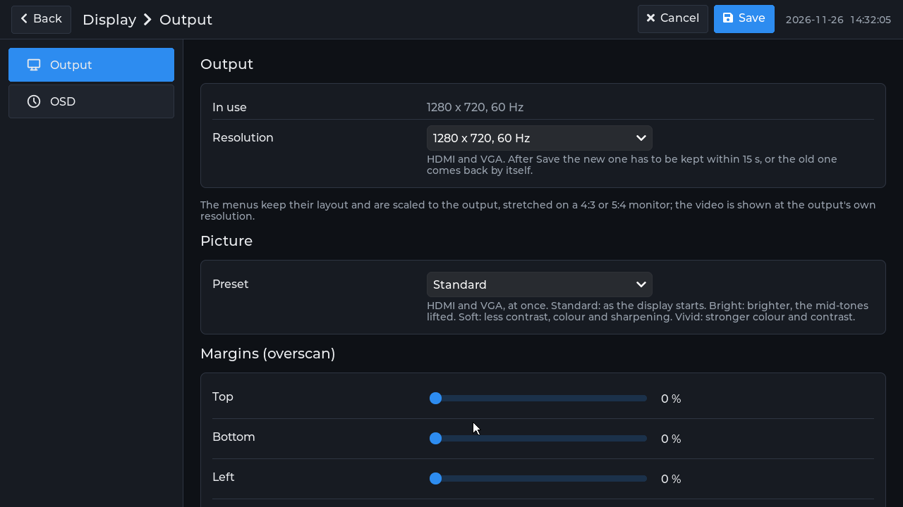

## Login and Exit

**Exit**, the context menu's last item, offers Logout, Reboot, Shutdown and
Cancel. Reboot and Shutdown ask first; then vigild stops as on SIGTERM
(each channel closes its recording), the disks are synced, and busybox's
`reboot` or `poweroff` runs (`mgmt_power_request`, also
`POST /api/v1/system/reboot` and `/system/shutdown`). Where vigild does not
manage the system (a desktop), it says so instead.

**The on-screen login** is off by default (`ui.login`, System > General >
Log in): everyone may do everything, and Logout is shown muted. Turned on,
the live view stays as it is, but the menus and settings ask for a user and
its password first, with vigil's users and groups (the Account pages,
`users.h`) and the system account (`api.user`, root), which always logs in
with every permission, so nobody is locked out. Each part needs its
permission: Camera and Channels `cameras`, Storage and Record `storage`,
Network `network`, Account `users`, System, Display, Operation, Reboot and
Shutdown `system`; the main menu itself, any user. A user without it is
told. The dialog lists the system account and the enabled users; the
password takes the on-screen keyboard for a mouse user. Exit > Logout, or
`ui.idle_logout` minutes (default 10; 0: never) without a key or the
mouse, end the session and go back to the live view.

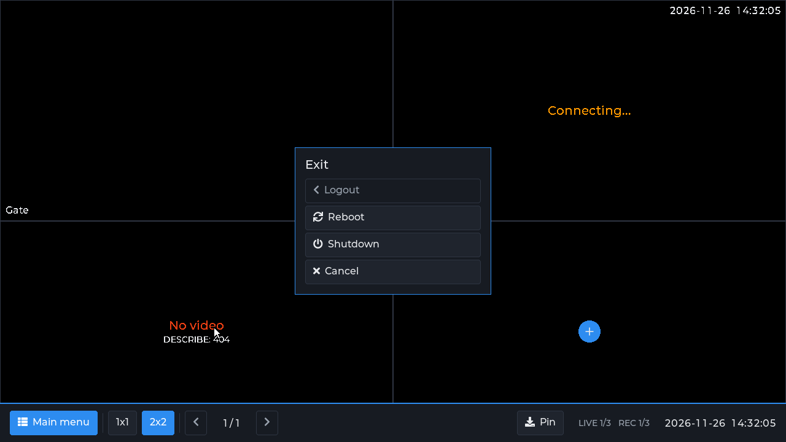

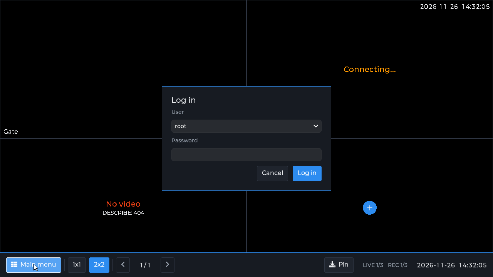

## Architecture

```
src/app/frontend_ui.c   main loop: lv_timer_handler, applying configurations (tick)
src/app/ui_bridge.c     ui_model_t from the core: channels_status, events cursor,
                        channels_set_tiles, config store + schema, system info
src/app/input_evdev.c   mice / touch screens -> LVGL pointer, right button -> back
        |
        v  ui_model.h (no core types)
src/ui/ui_app.c         screen stack, subjects, popups, toasts, questions
src/ui/ui_live.c        live view, clock, navigation bar, context menu, event toasts
src/ui/ui_menu.c        main menu
src/ui/ui_form.c        settings forms and lists, from the schema
src/ui/ui_channels.c    Channels: camera search (discovery jobs) and the channel table
src/ui/ui_system.c      System page
src/ui/ui_set_display.c Display: the output resolution (with its keep-or-undo question), clock, names, icons
src/ui/ui_layout.c      tile geometry (plain C, shared with frontend_tiles)
src/ui/ui_theme.c       LVGL styles from the design tokens
src/ui/ui_cursor.c      the mouse pointer's arrow
```

The layering rule holds: `src/ui` includes LVGL and `hal_ui.h` only. All
it knows about the rest of vigild is `ui_model.h`, a table of functions and
plain data that `src/app/ui_bridge.c` fills from the core. The tests fill
the same table with fake channels.

Everything runs on the main thread. Channel threads never touch LVGL:

- **Status**: every 250 ms the UI asks the model for each channel's
  snapshot (`channels_status()` underneath) and, when one changed, notifies
  that channel's `lv_subject`. Tiles and the navigation bar's totals observe the
  subjects, so they redraw only when something changed.
- **Events**: the UI has its own cursor on the events ring (as the API's
  WebSocket has), so it sees every event; each flashes its tile, and the
  ones that need attention become toasts (above).
- **Configuration**: the store's generation is a subject too. The camera
  list observes it and rebuilds when the configuration changed, whether
  the change came from this UI or from the HTTP API.
- **Clock** and **navigation bar pinned** are subjects as well; the live
  view's clock, the bar and the pages bind labels to the clock
  (`lv_label_bind_text`).

**Layouts move the video.** Changing the layout, the page or going full
screen computes the cells (`ui_layout_cells`) and hands one rectangle per
channel to `model->show_tiles`, which calls `channels_set_tiles()` in the
core. That moves each running channel's picture with the existing HAL calls
(`hal_display_set_tile`, or `hal_display_clear_tile` for a channel not on
the page) and remembers the tiles for channels that start later; the
platform fits the picture inside its tile at the shape the core gives it
(`hal_display_set_aspect`, below). The same
`ui_layout_cells` gives `frontend_tiles()` the start-up 2x2 tiles, so the
holes and the video cannot disagree.

**Sub-streams in small tiles.** The tile size also picks the stream: a
tile of a quarter of the screen or less (2x2 and smaller, the small
windows of the 8-split) shows the camera's sub-stream, a larger one (1x1,
full screen, the 8-split's large window) its main stream. The sub-stream is
the camera's `sub_url`, or for a NETIP camera the same URL with
`stream=extra`; a camera without either shows its main stream everywhere.
Both streams stay connected whatever is on screen, and each keeps the GOP
it is in, so full screen and back, or another page, shows the new stream
at once rather than at the camera's next keyframe (see
[architecture](architecture.md), "Main stream and sub-stream"); when there
is no GOP to start from, the old picture stays up until the new stream's
first keyframe (and the tile's state stays that picture's stream until
then). The tile's stream line
(`H.264 352x288 10 fps`) is the stream on screen; recording always takes
the main stream. Where decoders are scarce (`dec_shown_only`, SigmaStar)
channels not on the page decode nothing, and a tile whose camera is live
but which got no decoder (out of media memory or decoder channels) says
**No decoder** until one is free.

## Settings pages from the schema

The settings are the table in `src/core/config_schema.c`, the same one
`GET /api/v1/schema` serves. `ui_bridge.c` turns it into `ui_section_t` and
`ui_field_t` at start-up, and the UI builds every form from those at run
time:

| Schema type | Widget |
|---|---|
| string | one-line text area; the on-screen keyboard opens next to it (not once a keyboard is in use) |
| integer | text area for digits with `-` / `+` buttons kept within min..max; the range is shown |
| boolean | switch |
| enum | drop-down list of the values |

The field's `label` names the row and its `help` is shown under the widget.
A field that is not `live` carries "applies after restart". A section that
is an array of objects (the cameras) becomes a list with Add, Edit and
Remove; Edit and Add open a form for one item.

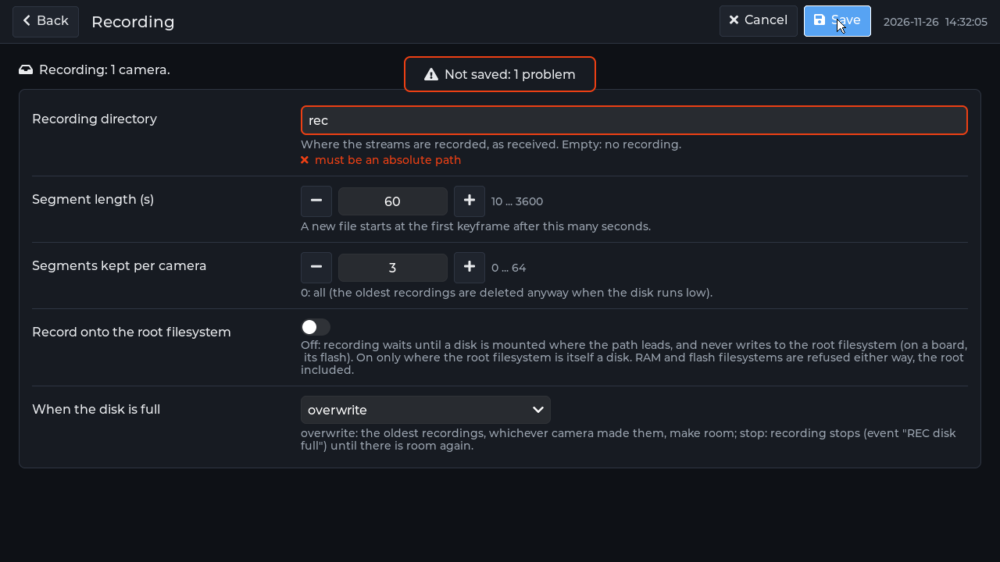

**Saving** sends the whole section to `config_put_json()`, the function
behind `PUT /api/v1/config/<section>`: the values are checked against the
schema, the file is saved atomically, the generation moves, and the main
loop applies the new configuration (`channels_apply`), exactly as for an
API request. When the store refuses, nothing is changed and each of its
errors (`record.path: must be an absolute path`) is shown under its field,
with a toast. A success shows "Saved" (or that some changes apply after a
restart); a configuration that was saved but whose directory sync failed
shows the store's warning.

**Secrets.** Camera URLs are shown as the API shows them, with the password
replaced by `***`. A URL saved back unchanged keeps the stored password
(the store's rule for `***`); typing a new URL replaces it.

Leaving a page with unsaved changes asks first. Removing a camera asks
first and saves at once.

**Camera slots.** Cameras are in channel order (`cameras[i]` is channel
i + 1), so a camera with an empty `url` is an empty slot: a camera can be
on channel 7 with 3 to 6 empty. The list shows an empty slot as "Empty"
with "Add here"; removing a camera empties its slot rather than moving the
later cameras up; empty slots at the end are not saved (`config_trim`). In
YAML an empty slot is `- url: ""` (or `- ~` by hand). In the UI model a
section with positions is `ui_section_t.slots`; `ui_form_open_slot(sec,
slot)` opens the form for a new item at a position.


### Channels: finding cameras and putting them on channels

The page CAMERA and the context menu's **Channels** open
(`ui_channels.c`) has two panes, as an NVR's camera page does.

**Search** (top): the protocol (all, NETIP, ONVIF, DHIP), **Search**
(its progress and how many have answered beside it), and a table of the
devices found: a check box, address, port, MAC, vendor and model, the
protocols that answered, and "New" or "On channel N" (the channel whose
camera URL points at that address). **Show** (after Select all) narrows
the table to the devices **Not added** to a channel or those **Added**
(as "On channel N" says), or shows **All**; the count beside it says "N
found, M shown", **Select all** checks the rows shown, and a device the
filter hides is not checked. Devices show **as they answer**: the
page polls the model's generation (`disc_gen`, moved by the core with each
answer that tells something new) and reads the devices only when it moved.
A row keeps its place while the list fills: a device already listed stays
where it is (a camera answering NETIP and later ONVIF is one row whose
protocols grow), a new one goes to the end, and rows are updated in place,
so the row under the pointer or the keyboard's focus does not move. A new
search starts from the list sorted by address; devices an earlier search
found are dimmed, "No answer", until they answer this one. While it runs,
Search is **Stop** (the search ends, keeping what it found), and the list
stays usable: Add, Add to..., a channel's +, and the Change IP, Mass change,
Auto add and Manual add pages stop it first (discovery runs one job at a
time). The two panes share the page 3:2, each table scrolling inside
(wheel, drag, or the keyboard's focus). A device row's **Add to...** opens a small menu of the empty
channels. The buttons act on the checked devices: **Add** puts each on
the next empty channel, **Change IP...** (one device) and **Mass
change...** (the checked ones, or all) open a page with the address, mask,
gateway and the credentials; the mass change's **Preview** shows which
device gets which address (addresses in use skipped) and **Apply** applies
exactly that. **Auto add all** asks for the credentials and fills the empty
channels with every new device, showing where each went or why not.
**Add with user / password** are the credentials Add uses (admin, empty
password by default); they are not kept, except in the URL of a camera
added. Discovery itself is in the core ([api.md](api.md#discovery)); the
page starts its jobs through the model (`disc_*` in `ui_model.h`) and
follows them on a timer, so the screen never waits for the network.
**Search settings** in the header opens the `discovery` section
(interfaces, addresses also asked, protocol order).

**Manual add** opens a page for a camera that the search does not find:
the protocol (NETIP (XMeye), ONVIF, Dahua (DHIP/RTSP), Generic RTSP), the
address or host name, the port (34567, 80, 554, 554 by protocol; it follows
a change of protocol until edited), user and password, the device's channel
(an NVR's or DVR's; not for plain RTSP), and for Generic RTSP the main and
optional sub-stream, each a path or a whole URL. The target channel is a
drop-down of every channel with the first empty one chosen (or the channel
the page was opened for); an occupied one
is asked about before it is replaced. **Test** connects as a channel would
and says "OK: H.264 1920x1080", or why not in the tiles' words
(Authentication error, Offline, Unsupported codec, No video, Not an ONVIF
device) with the device's message under it. **Save** puts the camera there
(for ONVIF with the stream URIs the camera gives then) and closes the page.

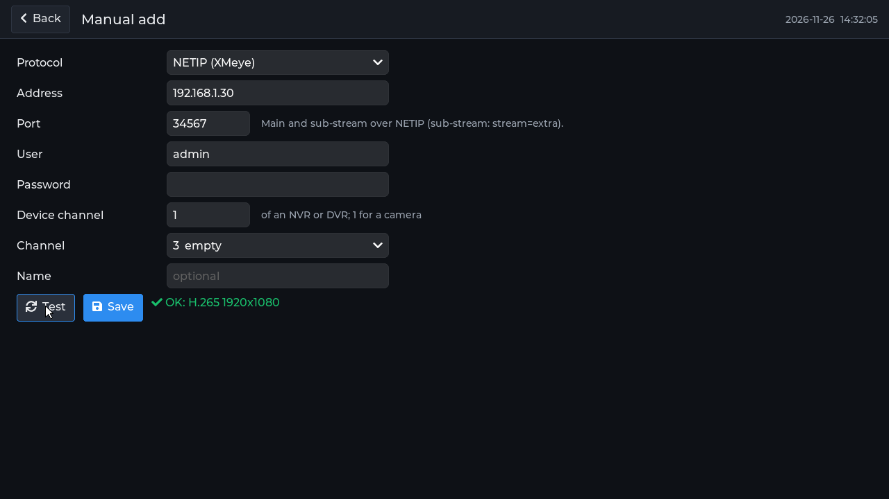

**Channels** (bottom): after the title, **Bandwidth**: what the cameras
bring in now, every stream (main and sub-stream) of every channel,
averaged over 2 s (the channels' `main_kbps` and `sub_kbps`), against what
the chip is rated for (`hal_caps()->max_in_kbps`: 64 Mbit/s on the
SSR621Q, from its recorders' spec sheets; only the current figure where the
platform does not know it). It turns amber from 80 % of the rating and red
over it. One row per channel: a check box, the camera's address (no URL,
no password), **X** on a channel with a camera (deletes it from the
channel, asked first) or **+** on an empty one (the one device checked
above goes there; otherwise Manual add opens with that channel chosen),
protocol, state (as the tiles say it; "Disabled" for a camera switched
off), and the channel's name (the configured one, else the camera's). A
click on a row checks it. The buttons beside the title act on the
channels checked: **Clear** deletes every channel's camera (asked first),
**Delete** the checked channels' cameras (asked first), **Edit** (one
checked) opens the camera form (a new camera on an empty channel), and
**Title** (one checked, with a camera) asks for the name the screen shows
for it, with the on-screen keyboard for the mouse; an empty name shows the
camera's own. A button that does not apply is greyed. Deleting empties
the slot: the cameras after it keep their channels.

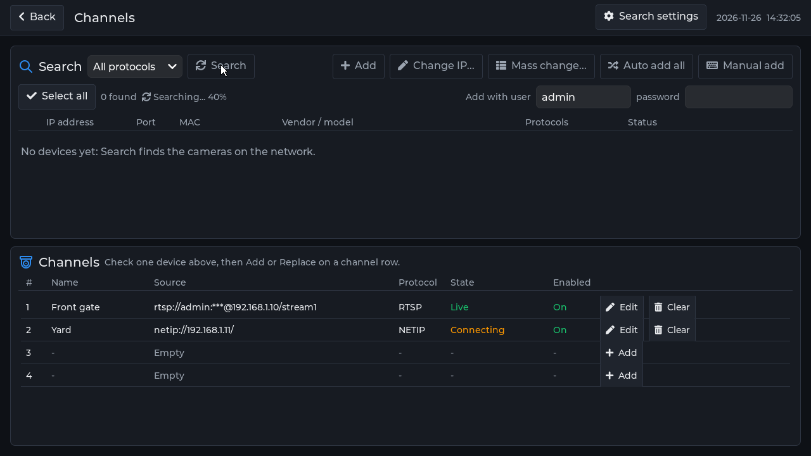
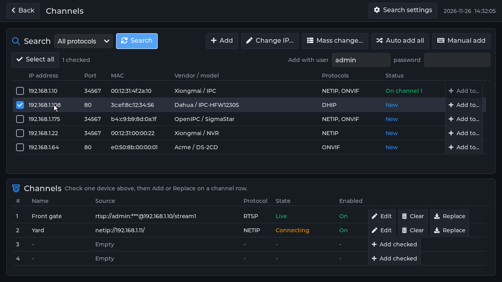
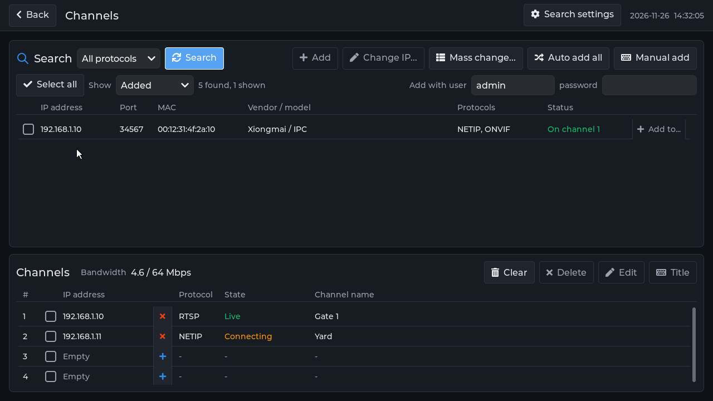
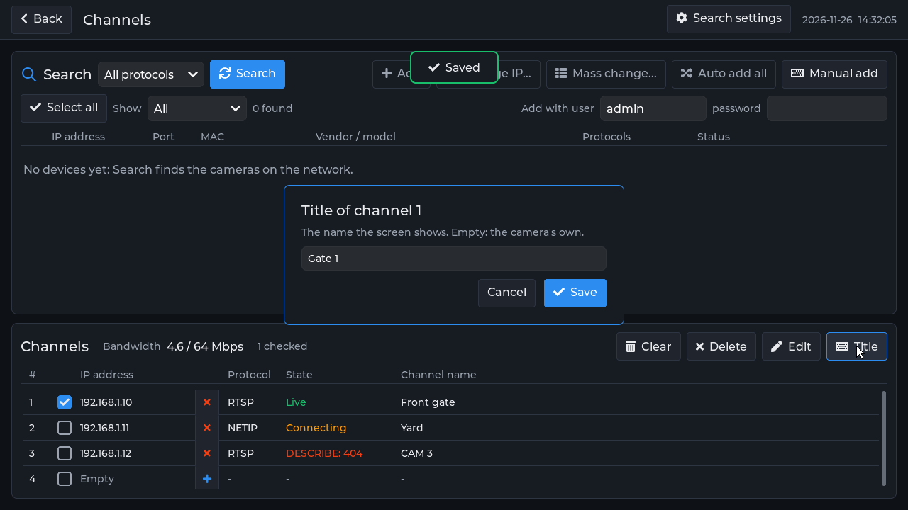
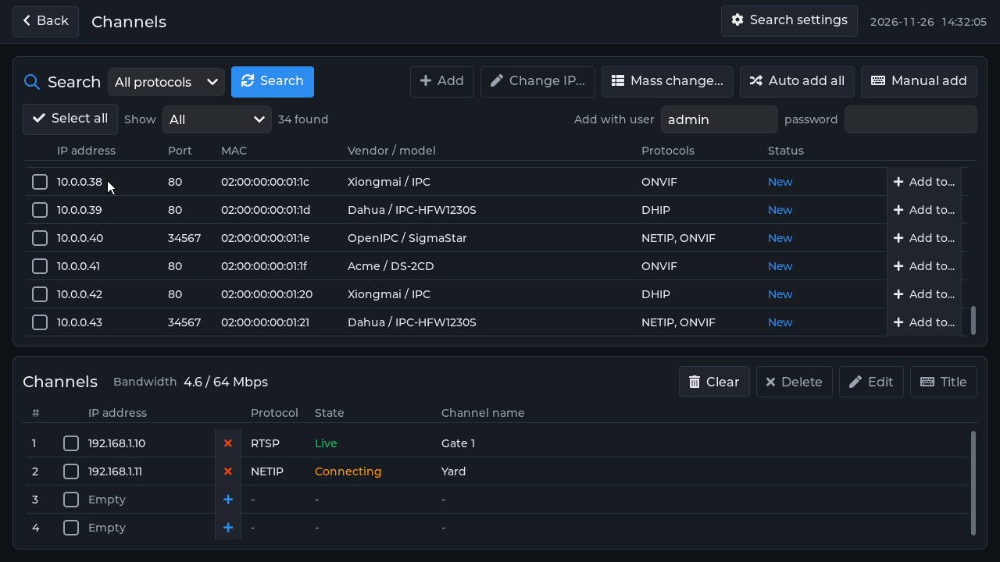
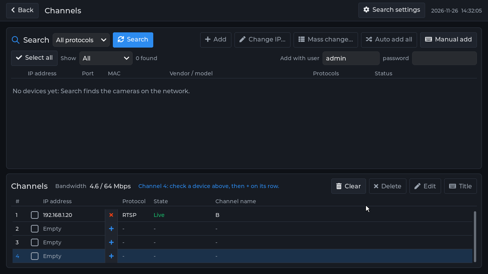
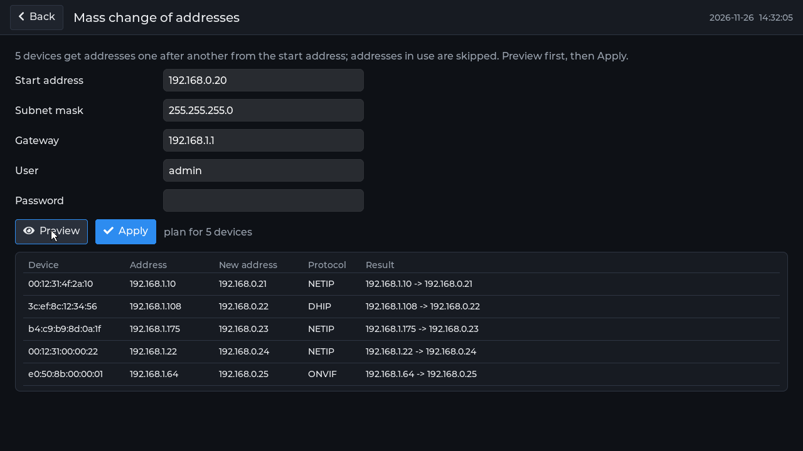

### The on-screen keyboard

For text entry with the mouse only (`ui_osk.c`): about 560 x 190 pixels,
a popup attached to the field, directly below it or above it when the
screen ends first, aligned with it and kept on the screen; it never covers
the field. Digits on top, QWERTY, Shift (one capital; twice, caps lock),
`#+=` to a page of every symbol a URL or a password needs
(`: / @ . - _ ? & = % # ! $ * + ~ , ; ' " ( ) [ ] { } < > \ | ^` and the
backquote), cursor keys, space and done. A number field gets digits and
`-`. It closes on done, Esc or the right button, and a click outside; a
click on another text field of the page moves it there. Once a keyboard
has been used, it does not open at all.

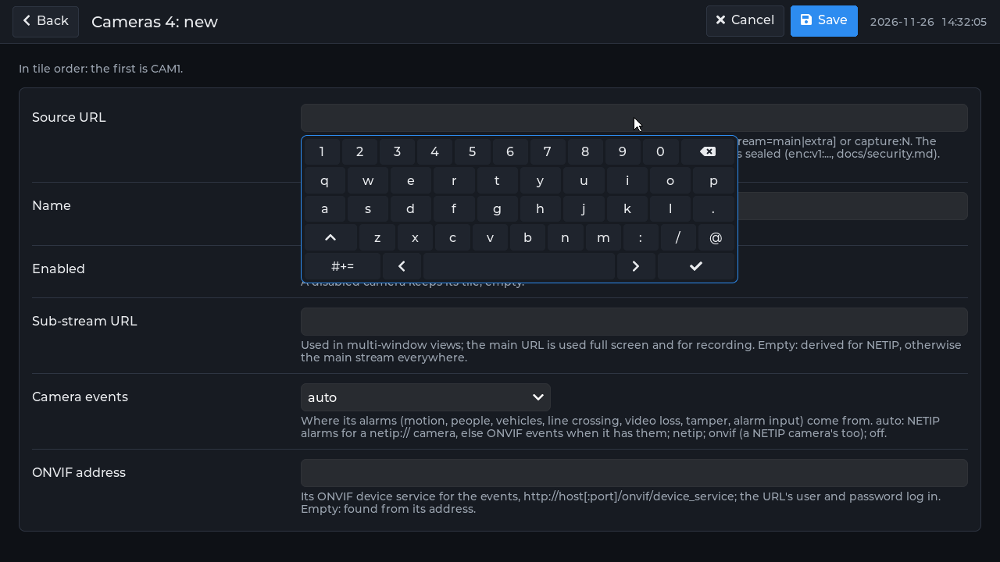

### Adding a setting to both UIs

1. Add the member to `vigil_config_t` (`src/core/config.h`).
2. Add a row to `src/core/config_schema.c`: key, type, default, limits,
   `label`, `help`, `live`, and a `check` function if it needs one.
3. Use the value where it applies (`channels_apply`, or wherever it is
   read).

Nothing else: the HTTP API, `GET /api/v1/schema` and the configuration
file follow from the row. On the screen, a new section is shown where it
belongs: as a sub-page of a settings screen (an item in its table in
`ui_set_<screen>.c` whose open() calls `ui_set_form`), or by a page of its
own.

### Words

The settings screens' words are a string table (`ui_i18n.h`): each a row
`X(S_ID, "English")`, used as `TR(S_ID)`. A translation is a table of the
same ids in `ui_i18n_<code>.c` and a line in `ui_i18n.c`'s list; the
Language selector (System › General, `ui.language`) offers exactly the
languages listed, English only for now. The older pages and the schema's
labels are still English in place; moving one is adding its row and using
`TR()`.

## Design tokens

The look is defined once, in `src/ui/theme.json`: colours of the dark NVR
theme (`bg`, `panel`, `panel2`, `hover`, `line`, `accent`, `ok`, `bad`,
`warn`, `text`, `text2`, `chip`, `focus`), spacing, radii, font sizes, component
sizes (including the keyboard focus ring, `focus_ring` and `focus_gap`)
and durations (navigation bar hide delay, double-click interval, toast). `scripts/gen-theme.py` (Python 3, standard library) generates

- `src/ui/theme_tokens.h`: `VG_COLOR_ACCENT`, `VG_SPACE_MD`,
  `VG_FONT_LG_LV` (the LVGL font), `VG_DURATION_NAVBAR_HIDE`, ...; and
- `web/theme.css`: the same values as CSS custom properties
  (`--vg-color-accent`, `--vg-space-md`, ...) for the web UI.

Both outputs are committed, so building needs no Python; the
`theme_tokens` test fails when they do not match `theme.json`. To change
the look: edit `theme.json`, run `scripts/gen-theme.py`, regenerate the
reference screenshots (below), commit all of it.

### Icons

The main menu's icons are [Tabler Icons](https://tabler.io/icons) (MIT,
`src/ui/icons/LICENSE`; the SVGs are in `src/ui/icons/`, from release
3.50.0). `scripts/gen-icons.py` renders each at the size it is shown at
(96 px on the cards, 28 px in the management row and the top bar) into
`src/ui/icons.c` and `icons.h` as LVGL **A8** images: alpha only, one byte
a pixel, coloured when drawn with `image_recolor` from the tokens
(`icon_playback`, `icon_ai`, ... for the cards). That is a quarter of
ARGB8888: six 96 px and five 28 px icons take 59 KB. Rendering uses
librsvg and cairo through ctypes (no Python packages); the generated files
are committed and record a hash of each source and of the parameters, so
the `ui_icons` test (`gen-icons.py --check`) needs neither library. To add
an icon: put its SVG in `src/ui/icons/`, add a line to the script's
`ICONS`, run it, commit all three.

Everything drawn over a video tile is opaque and has no shadow: on a
colour-keyed layer (HiSilicon hifb, SigmaStar GOP) a half-transparent pixel
is a blend with the key colour and shows as a pink fringe. For the same reason the chips over the video are square (a
rounded corner's soft edge is such a blend), and the round page arrows and
the "+" of an empty channel stand on a disc with hard edges (`ui_disc`:
every pixel opaque or not drawn, like the mouse pointer).

**Text straight on the video** (a tile's name and its state) has no chip:
`ui_outlined` draws it in a hard-edged version of the font (`ui_hard_font`:
the Montserrat glyphs with their anti-aliasing cut at a little under half,
every pixel opaque or not drawn) with a one-pixel black outline made of the
same glyphs drawn eight times around it. Nothing is blended, so nothing
fringes, and the outline keeps it readable on a bright or a dark picture.
The other way out, per-pixel alpha on the UI plane instead of the colour
key, was looked at: SigmaStar's GOP has it (`MI_FB_GlobalAlpha_t` with
`bAlphaChannel` in `sstarFb.h`, `FBIOSET_GLOBAL_ALPHA`), but the
emulator's GOP composites the plane opaque with only the key, so it could
not be checked there, and the HiSilicon boards would still key. Text on a
chip (menus, or a clock, name or icons with the `box` background) keeps its
smoothing: its edges lie on the chip. The icons over the video get the same
treatment as the text (`ui_osd_icon`: a hard-edged copy of the A8 icon,
outlined by drawing it eight times in black).

The screenshot target (below) shows it over a made-up picture
(`live-16-text-over-video.png`): with `--shots` the tests' screens use the
boards' magenta key and put a picture where it is, as the video layer
would, so a blended pixel would show as magenta there.

## Input

`src/app/input_evdev.c` reads every `/dev/input/event*` that is a pointer
or a keyboard. A mouse (relative X/Y and a left button) or a touch screen
or tablet (absolute X/Y) moves the one LVGL pointer; a keyboard (a device
with letter keys and Enter) types into the one LVGL keypad. Several of
each work at once. The directory is scanned again every 2 s, so a mouse or
a keyboard plugged in later works (the boards have no udev). The left
button clicks; the **right button** calls `ui_app_back`.

LVGL's own evdev driver (`LV_USE_EVDEV`) is not used: it opens one device
and reports only `BTN_MOUSE`/`BTN_TOUCH`, so the right button and the keys
would be lost. Button changes are queued, so a click shorter than LVGL's
input poll (16 ms) still counts. The reader is in `src/app` rather than
`src/core` (it needs Linux headers, which the core must not depend on) or
`src/ui` (LVGL only); it is plain Linux, so every platform with a display
uses it.

The pointer (`ui_cursor.c`, an arrow with only opaque and fully
transparent pixels) is shown while a pointer device is present. Where the
platform has a cursor plane (`hal_ui_cursor_create`; SigmaStar's GOP 0,
fbdev.ko's hardware cursor), the display draws it: a thread of the reader's
own wakes on each mouse event and hands the new position to the platform,
which moves the plane at the next frame, without LVGL redrawing anything.
So the pointer follows the mouse at the output's refresh rate (60 or 50
Hz) even while the UI is busy drawing a page; LVGL's pointer reads the same
position, under a lock, for clicks and hovering. Elsewhere LVGL draws it,
moving it at its frame rate: LVGL draws and polls the input every 16 ms
(`LV_DEF_REFR_PERIOD`), redrawing only the arrow's old and new places, and
the UI loop sleeps no longer than until LVGL's next timer.

**The zero channel** (`docs/api.md`, Zero channel) is this screen in a
browser at `http://<recorder>/`, for users with the `remote` permission.
Each viewer plugs one more absolute pointer and keyboard into this reader:
pipes (`input_evdev_attach`, `input_evdev_attach_keyboard`) that the web
server's threads write evdev events into (`src/app/kvm.c`), taken on the
LVGL thread. Its mouse, wheel, right button and keys are therefore those
of a USB mouse and keyboard, through the same code, and the monitor shows
its pointer. When a viewer goes, its pipes end and the reader lets go of
any button or modifier it held, as for a device unplugged. The pictures
are LVGL's own flushes (`LV_EVENT_FLUSH_START`) over the platform's
video; with a cursor plane the pointer is not among them (the browser shows
its own).

### Keyboard

**Layout.** Keys are translated in the reader with a US layout: Shift,
Caps Lock (letters only) and Num Lock (on at start: the keypad types
digits; off, its keys are arrows, Home, End, Page Up/Down and Delete), and
the keyboards' Caps Lock and Num Lock lights follow. There is no XKB: a
keyboard with another layout types the US characters of its keys.
Autorepeat is the kernel's (the repeats it reports for a key held down).
Each key reaches LVGL as a press and a release, so a held key never blocks
another keyboard; unplugging a keyboard drops its held Shift or Ctrl.

**Focus.** Every screen and popup has an `lv_group`: the live view (the
tile grid, then the navigation bar), each page (Back, the page's content
in reading order, then its actions such as Cancel and Save), the context
menu, a question, the help. Grids and lists are LVGL `gridnav`
containers: the arrows move between the tiles of the live view and of the
main menu, the rows of the camera list and the items of a menu. Tab and
Shift+Tab go through everything; Enter activates. The focused item has a
white ring (`focus` token): around a button or a field, and inside the
edge of a video tile or a list row, drawn on the UI layer over the
outermost pixels of the video rather than filling the hole.


**Mouse and keyboard together.** The focus is shown from the first key
until the last keyboard is unplugged; a mouse-only user never sees it.
The mouse's hover highlight and the keyboard's ring are separate states
and can be on two different things; clicking a tile or a field also moves
the keyboard's focus there, so Enter after a click means what was clicked.
The pointer stays as it is. Once the keyboard is in use, a text field no
longer opens the on-screen keyboard: type into it.

**Shortcuts** (F1 or `?` shows them on the screen):

| Where | Key | Does |
|---|---|---|
| live view | arrows | select a camera |
| | Enter | the selected camera full screen; again: back to the layout before |
| | `1`, `4`, `8`, `9`, `0` | 1, 4, 8, 9 or 16 windows, with the selected camera in view (up to what the platform shows) |
| | PgUp / PgDn, `[` / `]` | previous / next page |
| | `M`, F2 | main menu |
| | Menu key, Shift+F10 | context menu of the selected camera; Right (or Enter) on Split opens it, Left or Esc closes it |
| | Tab | to the navigation bar (it comes up while it has the focus) |
| | Esc | close a menu or popup; from the navigation bar back to the tiles |
| everywhere | Tab / Shift+Tab | next / previous item |
| | arrows | move between items (in a text field Left/Right move the cursor) |
| | Enter, Space | activate a button, turn a switch on or off |
| | Esc | back, as the right button; closes a popup first |
| | F1, `?` | help |
| forms | typing | goes into the focused text field |
| | Enter in a text field | next field (after the last: Save) |
| | Up / Down on a number | +1 / -1 |
| | arrows on a drop-down | previous / next value; Enter opens the list |
| | Ctrl+S | Save |
| | Esc with unsaved changes | asks first (Cancel is focused: Enter keeps the page) |
| Channels: devices | arrows, Enter or Space | move, check the device |
| Channels: channels | arrows, Enter or Space | move, check the channel |
| | E | edit the camera (an empty channel: add one) |
| | Delete | delete the channel's camera (asks first) |
| | A, + | an empty channel: the device checked above, else Manual add for it |


## Running and testing without a board

`test_ui` (built in every host build, run by `ctest`) is the UI without
hardware: LVGL renders into memory, pipes stand in for the mouse and the
keyboards and go through the real evdev reader, settings go through the real configuration
store (a file in the build directory), and only the channels, events and
clock are fakes. It walks through the screens with the mouse, checks the
widget states (tile texts, the navigation bar showing and hiding, the
context menu, full screen and back with the rectangles handed to the
platform, a validation error with nothing saved, a change saved and in
force, the camera password kept) and writes a screenshot of each step.
Then it does it again with the keyboard: moving the selection over the
tiles, full screen with Enter, `1`, `4`, the pages, the navigation bar and
the context menu, the help, the main menu by the arrows, typing into a
field (with a held key's repeats, Shift and Caps Lock), Enter to the next
field, a number stepped by the arrows, Ctrl+S saved and in force, Esc
asking before it discards, the camera list's rows, a switch, a drop-down,
and a keyboard unplugged with Shift held.

`tests/ui_compare.py` compares those with the references in `tests/ui/*.png`
(a pixel differs when a channel is off by more than 24; at most 0.3 % may
differ) and writes a `.diff.ppm` for a screen that does not match. After an
intended change to the look:

```sh
cmake --build build && (cd build && UPDATE=1 ctest -R ui_screens)
git add tests/ui
```

**Every screen, to look at.** `scripts/screenshots.sh BUILD [OUT]` (or
`cmake --build build --target screenshots`, into `build/screenshots/`)
writes a PNG of every screen and menu state with made-up but realistic
cameras (named, recording, one with motion, one connecting, one failing;
16 channels faked for the larger layouts): `live-2x2.png`,
`live-1x1.png`, `live-8.png`, `live-9.png`, `live-16.png`,
`live-navbar.png`, `live-overlays.png`, `live-focus.png`,
`context-menu.png`, `context-split.png`, `context-split-16.png`,
`menu-p1.png`, `menu-focus.png`, `not-available.png`, `cameras.png`,
`camera-form.png`, `camera-form-keyboard.png`, `confirm-discard.png`,
the settings screens (`network-*.png`, `storage-*.png`, `system-*.png`,
`account-*.png`, `settings-discard.png`: every sub-page, the Ethernet
question and error, the format panel, a painted schedule, a custom time
zone, the user editor),
`record.png`, `record-focus.png`, `validation-error.png`, `network.png`,
`display.png`, `system.png`, `help-f1.png`, and since then the page
arrows (`live-page-arrow-next.png`, `-prev`), every tile state and the
empty slots' "+" (`live-16.png`), `live-empty-plus-hover.png`,
`camera-add-channel-4.png`, the Channel info page (`channel-info.png`,
`channel-info-16.png`) and the on-screen keyboard (`osk-letters.png`,
`osk-shifted.png`, `osk-symbols.png`, `osk-above.png`), the text over a
picture (`live-16-text-over-video.png`), Exit (`context-menu-exit.png`,
`exit-chooser.png`, `reboot-confirm.png`, `shutdown-confirm.png`) and the
login (`login.png`, `login-keyboard.png`). They are for people reviewing
a change to the UI, not committed: run it after changing a screen or a
menu and look at the set. The `ui_screenshots` test only checks that the
walk still gets through every screen; the references above guard the
look.

The screenshots on this page are those references. No display, SDL or GPU
is needed, so this runs in CI. There is no interactive desktop simulator
yet: an LVGL SDL window (`hal_ui` for the generic platform) is the
natural next step.

On a board, `vigild` logs each input device it finds
(`input: <device> (<name>): mouse`, `... keyboard`) and when one goes
away.
