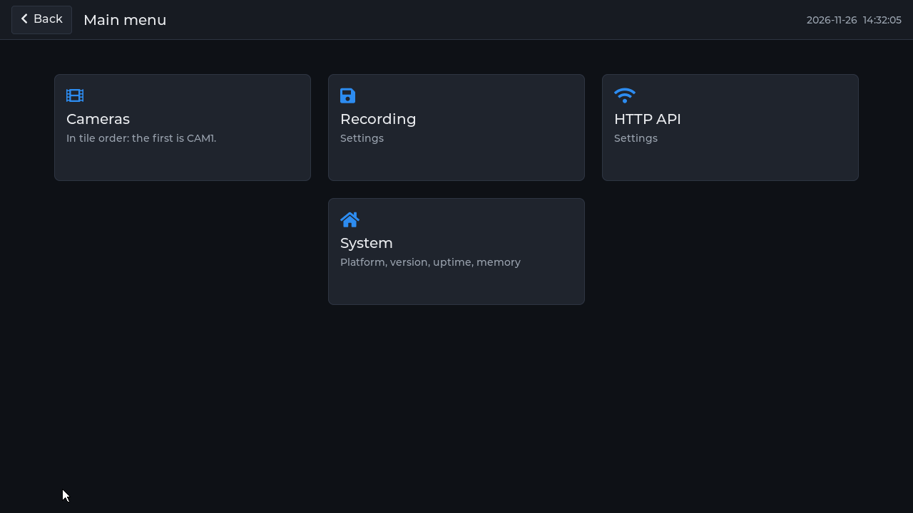
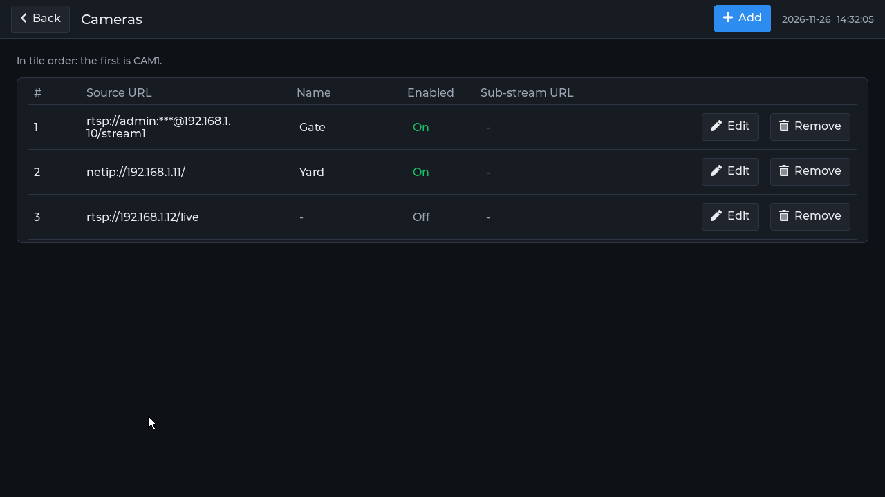
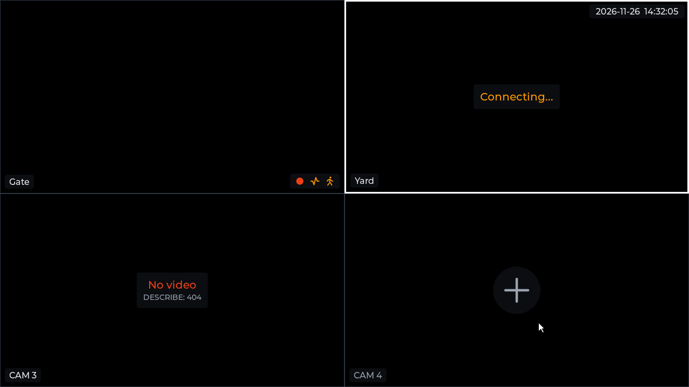
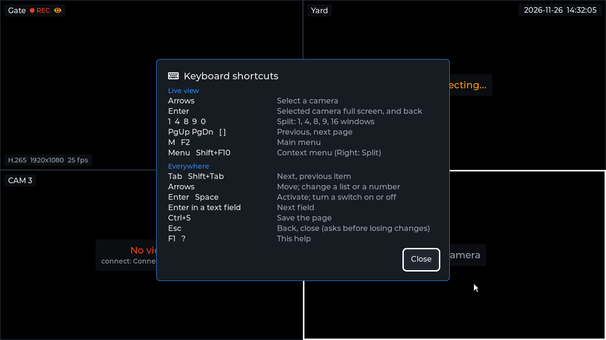

# The on-screen UI

`vigild` draws its user interface on the board's HDMI output with
[LVGL](https://lvgl.io) (v9.2), on the graphics layer above the video. It
is operated with a USB mouse (or a touch screen), a USB keyboard, or both.
This page describes how
the UI is built, how it gets its data, how the settings pages come from the
configuration schema, and how to run and test it without a board.


## Screens

```
live view                  tiles over the whole screen, clock in a corner
 |  navigation bar         bottom edge; Main menu, layouts, < page >, Pin, totals, clock
 |  context menu           right button: Main menu, Channels, Playback, Record, PTZ,
 |                         Display, Split > (layouts); full screen, pages, pin
 +-> Main menu             one tile per settings section + System
      +-> Cameras          the camera list: Add, Edit, Remove
      |    +-> a camera    form: URL, name, enabled
      +-> Recording        form
      +-> HTTP API         form
      +-> System           platform, version, uptime, memory, storage (read-only)
      +-> Display          output, clock corner, layouts (read-only for now)
```

**Live view.** The tiles take the whole screen (2x2 on a 1280x720 output:
four 640x360 tiles); there is no header or footer bar. Each tile is a
*hole*: LVGL paints it in the colour the platform keys out (or fully
transparent where the UI layer has alpha, `hal_ui_hole`), so the decoded
video below shows through. On it sit small opaque chips: top left the
camera's name from the configuration (or `CAM n`) with its status icons, a
red dot and `REC` while the channel records and an eye
(`LV_SYMBOL_EYE_OPEN`) while the camera reports motion; bottom left the
stream (`H.265 1920x1080 25 fps`); in the middle the state when there is
no picture (`Connecting...`, `No video` with the reason, `No camera`). A
tile flashes when its camera has an event.

The date and time are in a corner of the screen (top right;
`CLOCK_CORNER` in `ui_live.c` picks another corner or none, until the UI
has settings of its own), in an opaque chip like the tiles' labels.

Motion is wired through (`motion` in the channel status and in
`ui_chan_t`) but nothing reports it yet: the icon appears once a source
does (camera alarms over NETIP or ONVIF events are the next step).

**Events.** The live view has no event list; the HTTP API's WebSocket
carries every event. A tile shows its channel's state all the time, so
only what the tiles do not show becomes a toast at the top of the screen:
recording trouble (`REC failed`, `REC waiting for disk`, ...), a channel
that cannot run (`no decoder`, `bad URL`), a configuration that could not
be applied, and a camera going offline or coming back while its tile is not
on the screen. The same trouble on several cameras at once is one toast
(`2 cameras: REC waiting for disk`). `REC on`, `online` for a tile in
view, `config applied` and the like would only be noise.


The **navigation bar** slides up over the video when the pointer reaches
the bottom edge of the screen and hides 3 s after the pointer leaves it,
unless pinned. Besides the actions it shows the LIVE and REC totals and the
clock. **Double-clicking** a tile shows that channel full screen;
double-clicking again returns to the layout before.

The **context menu** (right button, or the Menu key) is, in this order:
**Main menu**; **Channels** (the camera list); **Playback**; **Record**
(the recording settings); **PTZ**; **Display** (output, clock corner and
layouts, read-only until the UI has settings of its own); **Split**, a
submenu of the layouts. Then, for the tile under the pointer, "Full
screen" (or "Back to the grid"), the pages when there are several, and
pinning the navigation bar. Playback and PTZ are not in vigil yet: they
are in the menu, muted, and say "not available yet" when chosen; they are
placeholders for what comes next.


**Split** offers 1, 4, 8, 9, 16, 32 and 64 windows, those up to the
number of channels the platform can show (`hal_caps()->max_channels`;
today every platform reports 4, so 1 and 4); the current one is checked.
The geometry is `ui_layout_cells`: N x N grids for 1, 4, 9, 16 and 64;
**8** is the classic one large window (3 x 3 cells of a 4 x 4 grid) with
three small ones down the right and four along the bottom; **32** is an
8 x 4 grid of equal windows, which on a 16:9 screen is the usual way to
show 32. Window edges are on 16-pixel columns and even rows. Paging walks
through the channels a page at a time (1 window with four cameras: four
pages). On a platform whose tiles are fixed (`fixed_tiles`, the
hi3520dv200 capture pipeline), only the 2x2 view is offered.


The 16- and 64-channel pictures here come from the headless test, which
fakes those capabilities.

**Main menu and pages.** Every page has a header with Back, its title,
its actions (Save, Cancel, Add) and the clock. Back is the header button,
the **right mouse button** or **Esc**, which go back one level (closing the
on-screen keyboard or a question first).



## Architecture

```
src/app/frontend_ui.c   main loop: lv_timer_handler, applying configurations (tick)
src/app/ui_bridge.c     ui_model_t from the core: channels_status, events cursor,
                        channels_set_tiles, config store + schema, system info
src/app/input_evdev.c   mice / touch screens -> LVGL pointer, right button -> back
        |
        v  ui_model.h (no core types)
src/ui/ui_app.c         screen stack, subjects, popups, toasts, questions
src/ui/ui_live.c        live view, clock, navigation bar, context menu, event toasts
src/ui/ui_menu.c        main menu
src/ui/ui_form.c        settings forms and lists, from the schema
src/ui/ui_system.c      System page
src/ui/ui_layout.c      tile geometry (plain C, shared with frontend_tiles)
src/ui/ui_theme.c       LVGL styles from the design tokens
src/ui/ui_cursor.c      the software mouse pointer
```

The layering rule holds: `src/ui` includes LVGL and `hal_ui.h` only. All
it knows about the rest of vigild is `ui_model.h`, a table of functions and
plain data that `src/app/ui_bridge.c` fills from the core. The tests fill
the same table with fake channels.

Everything runs on the main thread. Channel threads never touch LVGL:

- **Status**: every 250 ms the UI asks the model for each channel's
  snapshot (`channels_status()` underneath) and, when one changed, notifies
  that channel's `lv_subject`. Tiles and the navigation bar's totals observe the
  subjects, so they redraw only when something changed.
- **Events**: the UI has its own cursor on the events ring (as the API's
  WebSocket has), so it sees every event; each flashes its tile, and the
  ones that need attention become toasts (above).
- **Configuration**: the store's generation is a subject too. The camera
  list observes it and rebuilds when the configuration changed, whether
  the change came from this UI or from the HTTP API.
- **Clock** and **navigation bar pinned** are subjects as well; the live
  view's clock, the bar and the pages bind labels to the clock
  (`lv_label_bind_text`).

**Layouts move the video.** Changing the layout, the page or going full
screen computes the cells (`ui_layout_cells`) and hands one rectangle per
channel to `model->show_tiles`, which calls `channels_set_tiles()` in the
core. That moves each running channel's picture with the existing HAL calls
(`hal_display_set_tile`, or `hal_display_clear_tile` for a channel not on
the page) and remembers the tiles for channels that start later. The same
`ui_layout_cells` gives `frontend_tiles()` the start-up 2x2 tiles, so the
holes and the video cannot disagree. On SigmaStar the decoder's output
stays at the size of the tile it was opened for; a channel shown full
screen is scaled up by the display until its decoder is opened again.

## Settings pages from the schema

The settings are the table in `src/core/config_schema.c`, the same one
`GET /api/v1/schema` serves. `ui_bridge.c` turns it into `ui_section_t` and
`ui_field_t` at start-up, and the UI builds every form from those at run
time:

| Schema type | Widget |
|---|---|
| string | one-line text area; the on-screen keyboard opens on it (not once a keyboard is in use) |
| integer | text area for digits with `-` / `+` buttons kept within min..max; the range is shown |
| boolean | switch |
| enum | drop-down list of the values |

The field's `label` names the row and its `help` is shown under the widget.
A field that is not `live` carries "applies after restart". A section that
is an array of objects (the cameras) becomes a list with Add, Edit and
Remove; Edit and Add open a form for one item.


**Saving** sends the whole section to `config_put_json()`, the function
behind `PUT /api/v1/config/<section>`: the values are checked against the
schema, the file is saved atomically, the generation moves, and the main
loop applies the new configuration (`channels_apply`), exactly as for an
API request. When the store refuses, nothing is changed and each of its
errors (`record.path: must be an absolute path`) is shown under its field,
with a toast. A success shows "Saved" (or that some changes apply after a
restart); a configuration that was saved but whose directory sync failed
shows the store's warning.

**Secrets.** Camera URLs are shown as the API shows them, with the password
replaced by `***`. A URL saved back unchanged keeps the stored password
(the store's rule for `***`); typing a new URL replaces it.

Leaving a page with unsaved changes asks first. Removing a camera asks
first and saves at once.



### Adding a setting to both UIs

1. Add the member to `vigil_config_t` (`src/core/config.h`).
2. Add a row to `src/core/config_schema.c`: key, type, default, limits,
   `label`, `help`, `live`, and a `check` function if it needs one.
3. Use the value where it applies (`channels_apply`, or wherever it is
   read).

Nothing else: the HTTP API, `GET /api/v1/schema`, the configuration file
and the on-screen settings page all follow from the row. A new section
gets its own tile in the main menu (give it a symbol in
`ui_menu.c:section_symbol`, or it gets a generic one).

## Design tokens

The look is defined once, in `src/ui/theme.json`: colours of the dark NVR
theme (`bg`, `panel`, `panel2`, `hover`, `line`, `accent`, `ok`, `bad`,
`warn`, `text`, `text2`, `chip`, `focus`), spacing, radii, font sizes, component
sizes (including the keyboard focus ring, `focus_ring` and `focus_gap`)
and durations (navigation bar hide delay, double-click interval, toast). `scripts/gen-theme.py` (Python 3, standard library) generates

- `src/ui/theme_tokens.h`: `VG_COLOR_ACCENT`, `VG_SPACE_MD`,
  `VG_FONT_LG_LV` (the LVGL font), `VG_DURATION_NAVBAR_HIDE`, ...; and
- `web/theme.css`: the same values as CSS custom properties
  (`--vg-color-accent`, `--vg-space-md`, ...) for the web UI.

Both outputs are committed, so building needs no Python; the
`theme_tokens` test fails when they do not match `theme.json`. To change
the look: edit `theme.json`, run `scripts/gen-theme.py`, regenerate the
reference screenshots (below), commit all of it.

Everything drawn over a video tile is opaque and has no shadow: on a
colour-keyed layer (HiSilicon hifb, SigmaStar GOP) a half-transparent pixel
is a blend with the key colour and shows as a pink fringe.

## Input

`src/app/input_evdev.c` reads every `/dev/input/event*` that is a pointer
or a keyboard. A mouse (relative X/Y and a left button) or a touch screen
or tablet (absolute X/Y) moves the one LVGL pointer; a keyboard (a device
with letter keys and Enter) types into the one LVGL keypad. Several of
each work at once. The directory is scanned again every 2 s, so a mouse or
a keyboard plugged in later works (the boards have no udev). The left
button clicks; the **right button** calls `ui_app_back`.

LVGL's own evdev driver (`LV_USE_EVDEV`) is not used: it opens one device
and reports only `BTN_MOUSE`/`BTN_TOUCH`, so the right button and the keys
would be lost. Button changes are queued, so a click shorter than LVGL's
input poll (33 ms) still counts. The reader is in `src/app` rather than
`src/core` (it needs Linux headers, which the core must not depend on) or
`src/ui` (LVGL only); it is plain Linux, so every platform with a display
uses it.

The pointer is drawn by LVGL (`ui_cursor.c`, an arrow with only opaque and
fully transparent pixels), shown while a pointer device is present.

### Keyboard

**Layout.** Keys are translated in the reader with a US layout: Shift,
Caps Lock (letters only) and Num Lock (on at start: the keypad types
digits; off, its keys are arrows, Home, End, Page Up/Down and Delete), and
the keyboards' Caps Lock and Num Lock lights follow. There is no XKB: a
keyboard with another layout types the US characters of its keys.
Autorepeat is the kernel's (the repeats it reports for a key held down).
Each key reaches LVGL as a press and a release, so a held key never blocks
another keyboard; unplugging a keyboard drops its held Shift or Ctrl.

**Focus.** Every screen and popup has an `lv_group`: the live view (the
tile grid, then the navigation bar), each page (Back, the page's content
in reading order, then its actions such as Cancel and Save), the context
menu, a question, the help. Grids and lists are LVGL `gridnav`
containers: the arrows move between the tiles of the live view and of the
main menu, the rows of the camera list and the items of a menu. Tab and
Shift+Tab go through everything; Enter activates. The focused item has a
white ring (`focus` token): around a button or a field, and inside the
edge of a video tile or a list row, drawn on the UI layer over the
outermost pixels of the video rather than filling the hole.



**Mouse and keyboard together.** The focus is shown from the first key
until the last keyboard is unplugged; a mouse-only user never sees it.
The mouse's hover highlight and the keyboard's ring are separate states
and can be on two different things; clicking a tile or a field also moves
the keyboard's focus there, so Enter after a click means what was clicked.
The pointer stays as it is. Once the keyboard is in use, a text field no
longer opens the on-screen keyboard: type into it.

**Shortcuts** (F1 or `?` shows them on the screen):

| Where | Key | Does |
|---|---|---|
| live view | arrows | select a camera |
| | Enter | the selected camera full screen; again: back to the layout before |
| | `1`, `4`, `8`, `9`, `0` | 1, 4, 8, 9 or 16 windows, with the selected camera in view (up to what the platform shows) |
| | PgUp / PgDn, `[` / `]` | previous / next page |
| | `M`, F2 | main menu |
| | Menu key, Shift+F10 | context menu of the selected camera; Right (or Enter) on Split opens it, Left or Esc closes it |
| | Tab | to the navigation bar (it comes up while it has the focus) |
| | Esc | close a menu or popup; from the navigation bar back to the tiles |
| everywhere | Tab / Shift+Tab | next / previous item |
| | arrows | move between items (in a text field Left/Right move the cursor) |
| | Enter, Space | activate a button, turn a switch on or off |
| | Esc | back, as the right button; closes a popup first |
| | F1, `?` | help |
| forms | typing | goes into the focused text field |
| | Enter in a text field | next field (after the last: Save) |
| | Up / Down on a number | +1 / -1 |
| | arrows on a drop-down | previous / next value; Enter opens the list |
| | Ctrl+S | Save |
| | Esc with unsaved changes | asks first (Cancel is focused: Enter keeps the page) |
| camera list | Enter | edit the row |
| | Delete | remove the row (asks first) |



## Running and testing without a board

`test_ui` (built in every host build, run by `ctest`) is the UI without
hardware: LVGL renders into memory, pipes stand in for the mouse and the
keyboards and go through the real evdev reader, settings go through the real configuration
store (a file in the build directory), and only the channels, events and
clock are fakes. It walks through the screens with the mouse, checks the
widget states (tile texts, the navigation bar showing and hiding, the
context menu, full screen and back with the rectangles handed to the
platform, a validation error with nothing saved, a change saved and in
force, the camera password kept) and writes a screenshot of each step.
Then it does it again with the keyboard: moving the selection over the
tiles, full screen with Enter, `1`, `4`, the pages, the navigation bar and
the context menu, the help, the main menu by the arrows, typing into a
field (with a held key's repeats, Shift and Caps Lock), Enter to the next
field, a number stepped by the arrows, Ctrl+S saved and in force, Esc
asking before it discards, the camera list's rows, a switch, a drop-down,
and a keyboard unplugged with Shift held.

`tests/ui_compare.py` compares those with the references in `tests/ui/*.png`
(a pixel differs when a channel is off by more than 24; at most 0.3 % may
differ) and writes a `.diff.ppm` for a screen that does not match. After an
intended change to the look:

```sh
cmake --build build && (cd build && UPDATE=1 ctest -R ui_screens)
git add tests/ui
```

The screenshots on this page are those references. No display, SDL or GPU
is needed, so this runs in CI. There is no interactive desktop simulator
yet: an LVGL SDL window (`hal_ui` for the generic platform) is the
natural next step.

On a board, `vigild` logs each input device it finds
(`input: <device> (<name>): mouse`, `... keyboard`) and when one goes
away.
